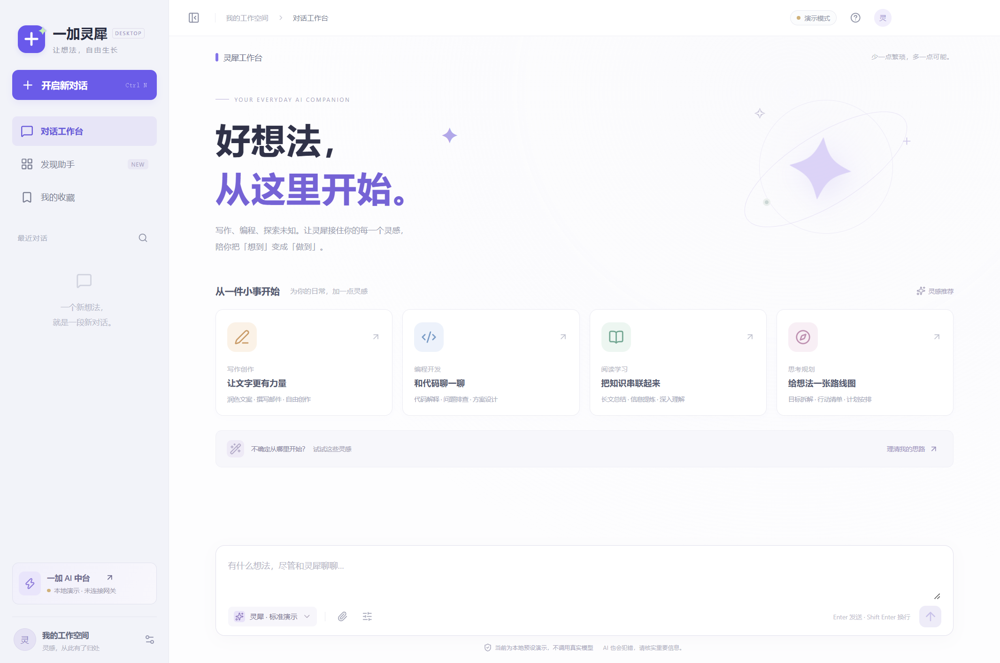
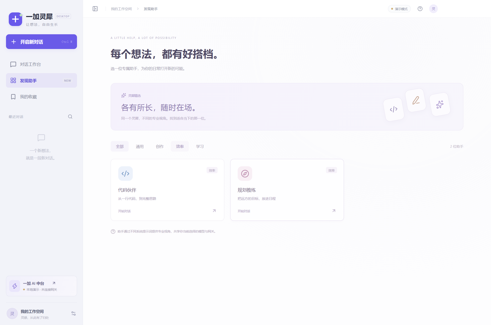
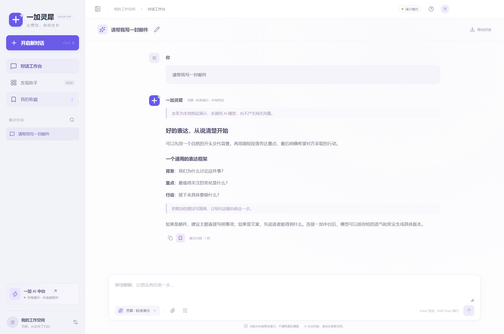

# 一加灵犀 · AI 桌面工作台

一加 AI 中台的独立下游应用，使用 **Electron + React + Vite**。本项目只实现桌面客户端与前端交互，不新增业务后端、数据库、模型服务或计费系统。

**版本：0.1.0 · Windows x64 · MIT**

[](https://github.com/yzxz111/yijia-lingxi/actions/workflows/ci.yml)

[GitHub 仓库](https://github.com/yzxz111/yijia-lingxi) · [版本与分发文件](https://github.com/yzxz111/yijia-lingxi/releases) · [上游一加 AI 中台](https://github.com/yzxz111/yijia-ai-platform)

> 已完成本地协议测试、受控服务桌面集成测试与 Windows 打包启动验证。默认提供明确标记的预设演示；真实中台与真实云模型仍待联调。



## 直接运行

### 从源码体验

准备 Node.js 22.12+ 和 npm（推荐 Node.js 24），在包含 `package.json` 的项目根目录执行：

```powershell
npm ci
npm start
```

首次启动会自动构建前端并打开 Electron，无需网关账号即可体验演示。修改前端后须先 `npm run build` 再启动；热更新开发使用 `npm run dev`。

### Windows 免安装包

如仓库 Releases 已提供 `yijia-lingxi-0.1.0-windows-x64.zip`，下载后**完整解压**，双击目录中的 `一加灵犀.exe`。无需安装 Node.js，不能只复制 EXE。当前分发包未做 Windows 代码签名。

本机自行打包的应用位于 `release/一加灵犀-win32-x64/`；根目录的 `启动一加灵犀.cmd` 可启动已构建的本机版本。`release/` 不进入源码仓库，源码下载包不附带 EXE。

首次打开处于**本地演示模式**：可以体验流式呈现、助手、历史记录、收藏和导出，但回答来自本地预设，不是实时模型推理。

## 连接一加 AI 中台

1. 启动已有的一加 AI 中台，在中台的「API 密钥」页面创建或取得有效 API Key，并确认该密钥有模型授权和可用套餐。
2. 在灵犀左下角点击工作空间旁的设置图标，或点击网关卡片 →「管理连接」。
3. 填写 API Base URL。本机默认是 `http://127.0.0.1:18081/v1`；支持填写根地址后自动补上 `/v1`。远程网关使用 HTTPS。
4. 粘贴 API Key，点击「连接网关并获取模型」。模型选择器只使用网关实际返回的目录。
5. 新建对话并发送消息；左下角网关卡片可查看实时套餐额度。

API Key 仅在本次运行内存中使用，不存入 localStorage、源码或配置文件。关闭客户端后需要重新填写。聊天、收藏和非敏感偏好保存在本机应用数据目录；关闭设置不会清除当前连接。

本项目不读取中台的密码文件、已有账号或秘密目录，也不自动购买套餐、创建密钥、修改配额或启动上游服务。

## 已实现功能

- 浅色桌面工作台：自定义标题栏、可折叠侧栏、首页场景卡片。
- 多轮流式聊天、Markdown / 代码块 / 表格展示、停止生成。
- 通用、写作、编程、阅读、规划、学习六位助手；通过不同系统提示词切换专业视角。
- 对话历史、本地持久化、标题重命名、全文搜索、单条删除、全部清空。
- 回复收藏、系统剪贴板复制、Markdown 对话导出。
- 文本附件：最多 3 个，每个不超过 150 KB；支持 TXT、Markdown、JSON、CSV 和常见代码文件。
- 从网关获取模型目录和实时套餐额度，提供温度和最大输出长度设置。
- 完整区分演示回复与网关回复；显示上游返回的 usage、请求 ID、错误和限流等待提示。
- `Ctrl N` 新建、`Ctrl K` 搜索、`Enter` 发送、`Shift Enter` 换行；可改为 `Ctrl Enter` 发送。





以上截图来自本地桌面自动化演示，未使用真实用户数据或真实模型输出。

## 客户端与上游的职责

```text
一加灵犀（React 前端）
        │ 受限 preload / IPC
Electron 桌面外壳（网络传输、取消、剪贴板）
        │ HTTPS / 本机 HTTP
一加 AI 中台（鉴权、模型路由、套餐、限流、计量）
        │
模型供应方
```

Electron 主进程只充当本地桌面外壳与网络适配层，不监听 HTTP 端口，不承担业务服务。渲染进程禁用 Node.js，开启上下文隔离、沙箱和 Web 安全；不加载远程页面，不开放任意 IPC 或系统命令。

浏览器预览直接请求网关，需要网关允许对应源的 CORS；桌面版通过受限 IPC 传输，无需关闭浏览器安全机制，也无需增加代理后端。

## 接口契约

当前客户端最小接入契约见 [网关接口说明](docs/gateway-contract.md)，无需取得原上游源码即可核对字段。当前接入范围：

| 功能 | 接口 | 认证 |
| --- | --- | --- |
| 授权模型目录 | `GET /v1/models` | `Authorization: Bearer <apiKey>` |
| 实时套餐额度 | `GET /v1/quota` | 同上 |
| 流式聊天 | `POST /v1/chat/completions` | 同上，`stream: true` |

`/v1/quota` 是一加中台扩展，并非所有 OpenAI 兼容服务都提供。额度缺失和聊天兼容性应分别核对。

本版使用已有 API Key 接入，不实现平台账号登录、托管 Key bootstrap、令牌刷新或购买流程。用户消息、所选助手的系统提示、已完成的对话上下文与附件会发送给配置的网关。停止或失败的助手回复保留在界面，但不作为下一轮助手上下文重发。

生成超时为 310 秒，目录与额度请求超时为 15 秒。生成请求**不自动重试**，以免不确定失败导致重复计费。SSE 处理跨网络块的中文 UTF-8、CRLF、心跳、usage、`[DONE]`、`finish_reason=length`、流中错误及不完整断流。取消生成会中止实际到网关的请求。

## 开发

需要 Node.js 22.12+ 与 npm。推荐使用 Node.js 24。

```powershell
npm ci
npm run dev          # 浏览器开发预览 http://127.0.0.1:5178
npm run build        # 生成静态前端 dist/
npm start            # 运行 Electron；没有 dist/ 时先构建
npm test             # 协议单元测试
npm run test:desktop # Electron 桌面集成测试
npm run check        # 文档链接、锁文件、常见凭据模式、协议测试和构建
npm run package      # 构建 Windows x64 免安装目录版
npm run test:package # 启动实际目录包验证
npm run release:zip  # Windows ZIP 与 SHA256SUMS.txt
```

桌面测试和 Windows 分发流程以 Windows 为验证平台。`test:desktop` 和 `test:package` 会打开测试窗口；桌面集成测试会操作系统剪贴板。不需要真实 API Key，也不访问真实模型。

GitHub Actions 已配置 Windows 安装、检查、桌面测试和打包流程，保留测试证据与分发产物。[当前远程构建结果](https://github.com/yzxz111/yijia-lingxi/actions)以实际 Actions 运行为准，本地通过不代表远程 CI 已通过。

前端热更新使用 `npm run dev`；Electron 启动加载的是 `dist/`，改动前端后应重新构建再启动。`release/` 是打包时快照，源码更新后需重新打包。本地开发可设置 `LINGXI_DATA_DIR` 使用隔离的数据目录；打包版忽略此环境变量。

## 目录

```text
assets/               品牌图标、应用图标和主题
.github/workflows/    Windows 自动检查与打包
docs/                 接口契约、展示截图和发布说明
electron/             安全桌面外壳与受限 preload
shared/gateway.mjs    共享网关客户端与 SSE 解析
src/                  React 工作台、演示、传输适配
scripts/              启动、图标生成、打包、桌面测试
tests/                网关协议测试
dist/                 静态前端构建产物
release/              Windows 免安装应用
test-results/         测试结果、截图和隔离测试档案
项目说明.md            项目介绍与可如实使用的简历表述
验收记录.md            本次本地验证证据与限制
```

## 使用边界

本地存储没有云同步或加密功能，勿将聊天历史当成机密保险箱。最多保存 100 个对话、每个 200 条消息。附件按文本送入上下文，本版不做 PDF / Word 解析、图片识别、联网搜索或自主执行工具。

上游可能接入模拟供应方。即便连接成功，也应核对其实际模型渠道；模拟模型返回内容不代表真实云模型验收。本项目不会根据模型名推断其真实性。

## 项目资料与发布

- [项目介绍与简历表述](项目说明.md)
- [本地验收记录](验收记录.md)
- [发布整理验证摘要](docs/release-verification.json)
- [GitHub 发布指南](docs/PUBLISHING.md)
- [v0.1.0 发布说明](docs/releases/v0.1.0.md)
- [更新记录](CHANGELOG.md)

## 许可证

应用自有代码采用 [MIT License](LICENSE)。第三方依赖遵循各自许可，见 [THIRD_PARTY_NOTICES.md](THIRD_PARTY_NOTICES.md)。
